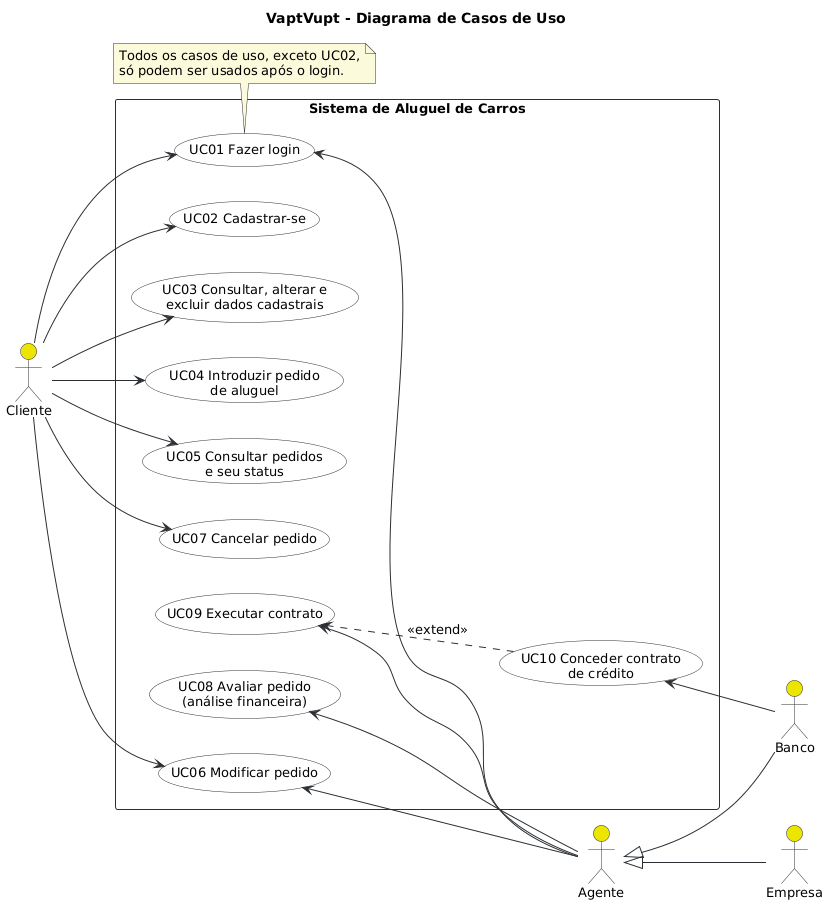
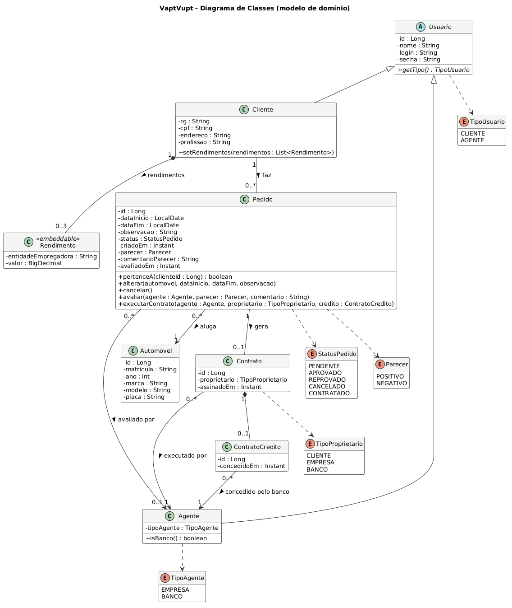
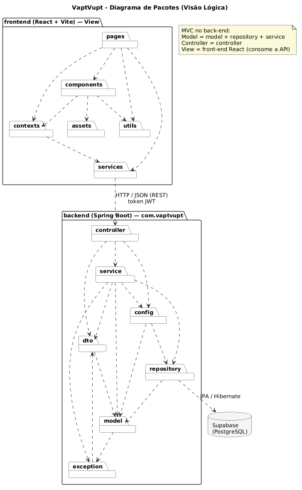
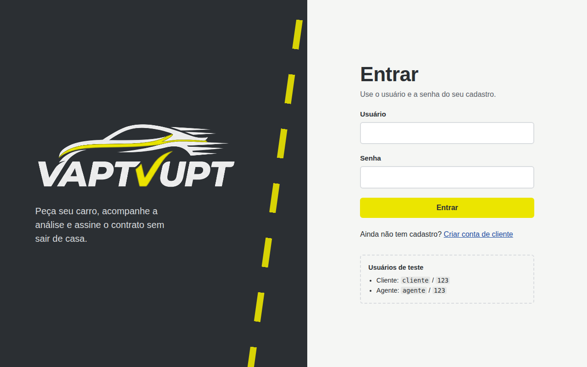
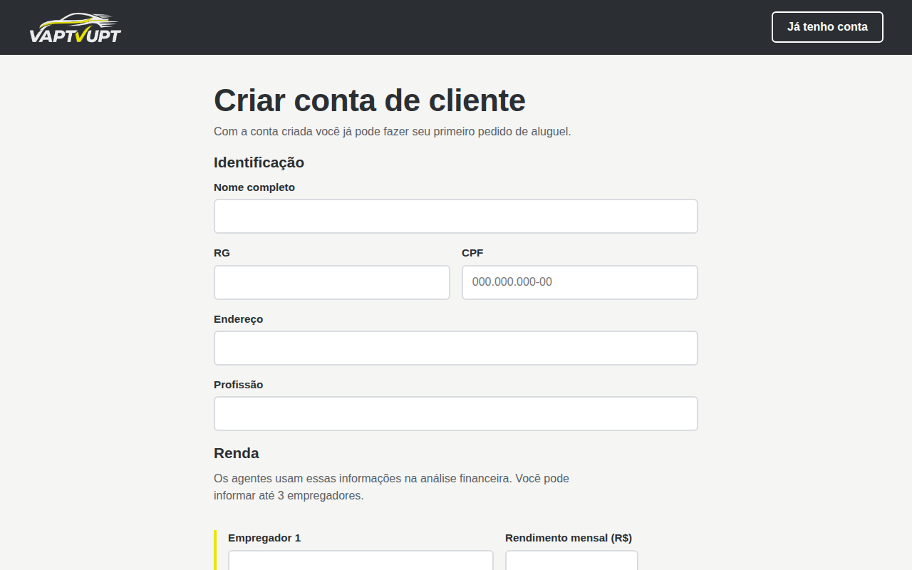
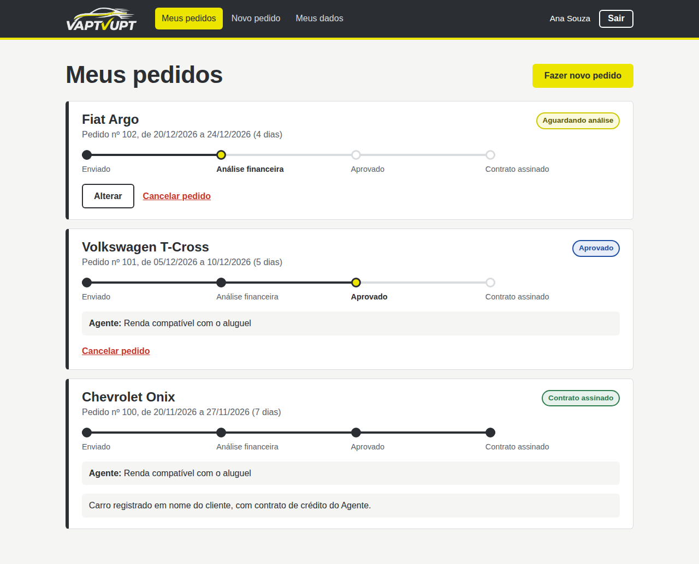
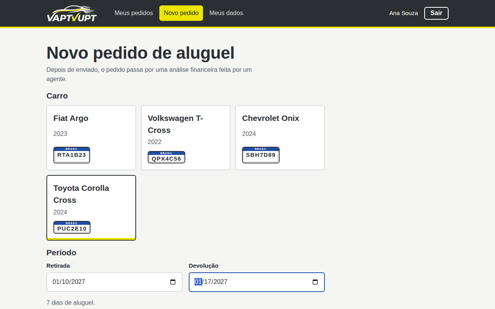
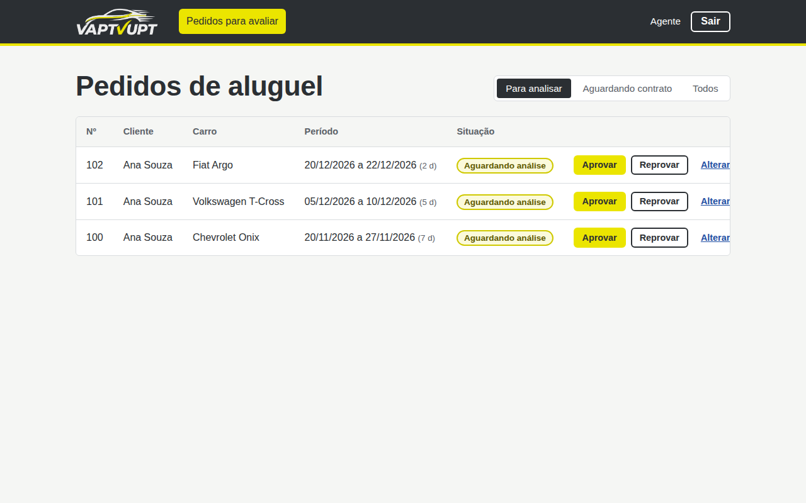

# 🚗 VaptVupt — Sistema de Aluguel de Carros

<table>
  <tr>
    <td width="800px">
      <div align="justify">
        O <b>VaptVupt</b> permite que clientes façam pedidos de aluguel de automóveis, acompanhem cada etapa da análise e cancelem ou modifiquem pedidos sem sair de casa. Do outro lado, <b>agentes</b> (empresas e bancos) avaliam os pedidos do ponto de vista financeiro, podem modificá-los e executam o contrato, que pode incluir um <b>contrato de crédito</b> concedido por um banco. Projeto desenvolvido no <i>Laboratório 02</i> da disciplina <b>Desenvolvimento e Integração de Aplicações Web (DIAW)</b> do curso de Engenharia de Software da PUC Minas.
      </div>
    </td>
    <td>
      <div>
        
      </div>
    </td>
  </tr>
</table>

---

## 🚧 Status do Projeto

      

---

## 📚 Índice
- [Links Úteis](#-links-úteis)
- [Sobre o Projeto](#-sobre-o-projeto)
- [Funcionalidades Principais](#-funcionalidades-principais)
- [Tecnologias Utilizadas](#-tecnologias-utilizadas)
- [Arquitetura](#-arquitetura)
- [Modelagem](#-modelagem)
- [Instalação e Execução](#-instalação-e-execução)
  - [Pré-requisitos](#pré-requisitos)
  - [Variáveis de Ambiente](#-variáveis-de-ambiente)
  - [Banco de Dados (Supabase)](#-banco-de-dados-supabase)
  - [Instalação de Dependências](#-instalação-de-dependências)
  - [Como Executar a Aplicação](#-como-executar-a-aplicação)
- [Endpoints da API](#-endpoints-da-api)
- [Estrutura de Pastas](#-estrutura-de-pastas)
- [Demonstração](#-demonstração)
- [Testes](#-testes)
- [Documentações utilizadas](#-documentações-utilizadas)
- [Autor](#-autor)
- [Agradecimentos](#-agradecimentos)

---

## 🔗 Links Úteis
* 📖 **Histórias de Usuário:** [docs/historias-de-usuario.md](docs/historias-de-usuario.md)
* 📐 **Diagramas UML:** [docs/diagramas](docs/diagramas) (fontes em PlantUML e imagens)

---

## 📝 Sobre o Projeto

Alugar um carro normalmente exige ir até a locadora, preencher papelada e esperar a análise de crédito sem saber em que pé ela está. O VaptVupt leva esse processo para a internet:

- **O cliente** se cadastra, informa seus dados e rendimentos, escolhe o carro e as datas e acompanha o pedido numa trilha de status (enviado → análise financeira → aprovado → contrato assinado).
- **O agente** (empresa ou banco) vê os pedidos enviados, faz a análise financeira, dá o parecer, pode modificar pedidos ainda não analisados e executa o contrato dos aprovados, definindo em nome de quem o carro fica registrado. Bancos ainda podem associar um contrato de crédito ao aluguel.

O sistema só pode ser usado após cadastro e login. Ele é dividido em dois subsistemas, como pede a especificação: a **gestão de pedidos e contratos** (API Spring Boot) e a **construção dinâmica das páginas web** (React).

---

## ✨ Funcionalidades Principais

- 🔐 **Autenticação:** login obrigatório com usuário e senha (senhas com hash BCrypt e sessão por token JWT).
- 👤 **CRUD de cliente:** cadastro com RG, CPF, nome, endereço, profissão e até 3 entidades empregadoras com rendimento; consulta, alteração e exclusão da conta.
- 📝 **Pedidos de aluguel:** o cliente introduz, consulta, modifica e cancela pedidos.
- 🧾 **Análise financeira:** o agente dá parecer positivo ou negativo, com comentário visível para o cliente.
- ✏️ **Modificação pelo agente:** pedidos ainda não analisados podem ser ajustados pelo agente.
- 🤝 **Execução de contrato:** pedidos aprovados viram contrato; o carro é registrado em nome do cliente, da empresa ou do banco.
- 🏦 **Contrato de crédito:** bancos agentes podem conceder crédito associado ao aluguel.
- 🚦 **Status em tempo real:** trilha visual mostrando em que etapa cada pedido está.

---

## 🛠 Tecnologias Utilizadas

### 💻 Front-end

* **Biblioteca:** React 18.3.1
* **Roteamento:** React Router 6
* **Linguagem:** JavaScript (ES2022+)
* **Estilização:** CSS puro com variáveis (identidade visual própria)
* **Gerenciamento de Estado:** Context API (sessão do usuário)
* **Build Tool:** Vite 6

### 🖥️ Back-end

* **Linguagem:** Java 25 (JDK 25)
* **Framework:** Spring Boot 4.0.9 (Spring MVC)
* **Build e dependências:** Apache Maven 3.9 (com Maven Wrapper)
* **Banco de Dados:** Supabase (PostgreSQL)
* **ORM:** Spring Data JPA / Hibernate
* **Autenticação:** Spring Security + JWT (OAuth2 Resource Server)
* **Validação:** Jakarta Bean Validation

---

## 🏗 Arquitetura

O sistema segue a arquitetura **MVC**, separada em front-end e back-end que conversam por uma **API REST** em JSON:

- **View (front-end React):** telas em `frontend/src/pages`, componentes reutilizáveis em `components`, sessão em `contexts` e todas as chamadas HTTP concentradas em `services`. As telas nunca chamam `fetch` diretamente.
- **Controller (`backend/.../controller`):** recebe as requisições REST, valida a entrada (DTOs) e delega para os serviços.
- **Model (`model`, `service`, `repository`):** entidades JPA com as regras de estado do pedido, serviços com as regras de negócio e permissões, e repositórios Spring Data que acessam o PostgreSQL do Supabase.

Padrões adotados: **DTO** (os dados que entram e saem da API são separados das entidades), **Repository**, **Service Layer** e um **tratador global de exceções** que devolve sempre `{ "message": "..." }`, que o front-end mostra ao usuário.

**Fluxo de autenticação:** o login devolve um token JWT assinado (HS256) com o id do usuário e o perfil (`CLIENTE` ou `AGENTE`). O front-end envia o token no cabeçalho `Authorization: Bearer` em toda requisição, e o Spring Security libera cada rota conforme o perfil.

**Ciclo de vida do pedido:**

```
PENDENTE ──(parecer positivo)──► APROVADO ──(executar contrato)──► CONTRATADO
    │                                │
    ├──(parecer negativo)──► REPROVADO
    └──(cliente cancela)───► CANCELADO ◄──(cliente cancela)──┘
```

---

## 📐 Modelagem

| Diagrama de Casos de Uso | Diagrama de Classes |
| :---: | :---: |
|  |  |
| **Diagrama de Pacotes (Visão Lógica)** | **Histórias de Usuário** |
|  | [11 histórias com critérios de aceitação](docs/historias-de-usuario.md) |

As fontes dos diagramas estão em PlantUML (`docs/diagramas/*.puml`), então dá para editá-los e gerar as imagens de novo conforme o projeto evoluir.

---

## 🔧 Instalação e Execução

### Pré-requisitos

* **Java JDK 25** (para o back-end)
* **Node.js** LTS 18 ou superior, com npm (para o front-end)
* **Conta no Supabase** com um projeto criado (banco de dados)
* O Maven **não** precisa estar instalado: o projeto usa o Maven Wrapper (`mvnw`).

---

### 🔑 Variáveis de Ambiente

#### 1 Back-end (Spring Boot)

Copie `backend/.env.example` para `backend/.env` e preencha. O Spring lê esse arquivo automaticamente ao iniciar.

| Variável | Descrição | Exemplo |
| :--- | :--- | :--- |
| `SUPABASE_DB_URL` | URL JDBC do banco no Supabase (Session pooler), sem usuário e senha. | `jdbc:postgresql://aws-0-sa-east-1.pooler.supabase.com:5432/postgres?sslmode=require` |
| `SUPABASE_DB_USER` | Usuário do pooler. | `postgres.abcdefghijklmnop` |
| `SUPABASE_DB_PASSWORD` | Senha do banco definida ao criar o projeto. | `senha-do-banco` |
| `JWT_SECRET` | Segredo para assinar os tokens de login (mínimo 32 caracteres). | `um-texto-aleatorio-bem-grande-1234567890` |
| `SERVER_PORT` | Porta da API (opcional). | `8080` |

#### 2 Front-end (React, Vite)

Opcional. Crie `frontend/.env` a partir de `frontend/.env.example`.

| Variável | Descrição | Exemplo |
| :--- | :--- | :--- |
| `VITE_USE_MOCK` | `false` (padrão) usa a API Spring Boot; `true` usa dados simulados no navegador, sem back-end. | `false` |

Em desenvolvimento, o Vite repassa tudo que começa com `/api` para `http://localhost:8080`, então não é preciso configurar a URL da API.

---

### 💾 Banco de Dados (Supabase)

1. Crie um projeto em [supabase.com](https://supabase.com) e guarde a senha do banco.
2. No painel do projeto, clique em **Connect** → **Connection String** → **Type: JDBC** → **Method: Session pooler**.
3. A string tem o formato `jdbc:postgresql://HOST:5432/postgres?user=USUARIO&password=[YOUR-PASSWORD]`. Separe as partes no `backend/.env`:
   - `SUPABASE_DB_URL` = `jdbc:postgresql://HOST:5432/postgres?sslmode=require`
   - `SUPABASE_DB_USER` = o valor de `user`
   - `SUPABASE_DB_PASSWORD` = a senha do banco
4. Não é preciso criar tabelas: na primeira execução o Hibernate cria tudo (`ddl-auto=update`) e o sistema cadastra os usuários de teste e os carros.

> [!TIP]
> Use o **Session pooler** e não a conexão direta: a conexão direta do Supabase usa IPv6, que muitas redes domésticas e da faculdade não suportam.

---

### 📦 Instalação de Dependências

```bash
git clone <URL_DO_REPOSITÓRIO>
cd Sistema-Aluguel-de-Carros
```

#### Front-end (React)

```bash
cd frontend
npm install
cd ..
```

#### Back-end (Spring Boot)

```bash
cd backend
./mvnw clean install      # Windows (PowerShell): .\mvnw clean install
cd ..
```

---

### ⚡ Como Executar a Aplicação

Use **dois terminais**.

#### Terminal 1: Back-end (Spring Boot)

```bash
cd backend
./mvnw spring-boot:run    # Windows (PowerShell): .\mvnw spring-boot:run
```
🚀 *A API fica disponível em **http://localhost:8080**.*

#### Terminal 2: Front-end (React, Vite)

```bash
cd frontend
npm run dev
```
🎨 *O sistema fica disponível em **http://localhost:5173**.*

**Usuários de teste** (criados automaticamente):

| Perfil | Usuário | Senha |
| :--- | :--- | :--- |
| Cliente | `cliente` | `123` |
| Agente (banco) | `agente` | `123` |

> [!NOTE]
> Para ver as telas sem o back-end, rode o front-end com `VITE_USE_MOCK=true` no `frontend/.env`. Os dados ficam salvos no navegador.

---

## 🔌 Endpoints da API

Todas as rotas exigem `Authorization: Bearer <token>`, exceto login e cadastro.

| Método | Rota | Perfil | Descrição |
| :--- | :--- | :--- | :--- |
| POST | `/api/auth/login` | público | Login: `{login, senha}` → `{token, usuario}` |
| GET | `/api/auth/me` | logado | Usuário da sessão |
| POST | `/api/clientes` | público | Cadastro de cliente |
| GET | `/api/clientes/{id}` | cliente (o próprio) ou agente | Consultar cliente |
| PUT | `/api/clientes/{id}` | cliente (o próprio) | Alterar dados |
| DELETE | `/api/clientes/{id}` | cliente (o próprio) | Excluir conta |
| GET | `/api/automoveis` | logado | Listar carros |
| GET | `/api/pedidos/meus` | cliente | Pedidos do cliente logado |
| POST | `/api/pedidos` | cliente | Introduzir pedido |
| GET | `/api/pedidos/{id}` | dono ou agente | Consultar pedido |
| PUT | `/api/pedidos/{id}` | dono ou agente | Modificar pedido pendente |
| PATCH | `/api/pedidos/{id}/cancelar` | cliente | Cancelar pedido |
| GET | `/api/pedidos` | agente | Todos os pedidos |
| PATCH | `/api/pedidos/{id}/avaliar` | agente | Parecer `{parecer: POSITIVO\|NEGATIVO, comentario}` |
| POST | `/api/pedidos/{id}/contrato` | agente | Executar contrato `{proprietario: CLIENTE\|EMPRESA\|BANCO, comCredito}` |

Exemplo com cURL:

```bash
curl -X POST http://localhost:8080/api/auth/login \
     -H "Content-Type: application/json" \
     -d '{"login":"cliente","senha":"123"}'
```

Saída esperada (resumida):

```json
{
  "token": "eyJhbGciOiJIUzI1NiJ9...",
  "usuario": { "id": 2, "tipo": "CLIENTE", "nome": "Cliente", "login": "cliente" }
}
```

---

## 📂 Estrutura de Pastas

```
.
├── README.md
├── .gitignore
│
├── frontend/                        # 📁 Aplicação React + Vite (View)
│   ├── .env.example                 # 🧩 VITE_USE_MOCK
│   ├── index.html
│   ├── vite.config.js               # 🔀 Proxy /api → localhost:8080
│   ├── public/                      # 🖼️ Favicon
│   └── src/
│       ├── assets/                  # 🖼️ Logo
│       ├── components/              # 🧱 Layout, formulários, placa, trilha de status
│       ├── contexts/                # 🔐 AuthContext (sessão)
│       ├── pages/                   # 📄 Login, Cadastro, Meus pedidos, Novo pedido, Perfil
│       │   └── agente/              # 🧾 Painel do agente
│       ├── services/                # 🔌 Chamadas à API + mockApi (modo simulado)
│       ├── styles/                  # 🎨 global.css
│       └── utils/                   # 🛠️ Formatação (data, CPF)
│
├── backend/                         # 📁 API Spring Boot
│   ├── .env.example                 # 🧩 Conexão com o Supabase e JWT
│   ├── pom.xml
│   ├── mvnw / mvnw.cmd              # ⚙️ Maven Wrapper
│   └── src/main/
│       ├── java/com/vaptvupt/
│       │   ├── controller/          # 🎮 Endpoints REST
│       │   ├── service/             # ⚙️ Regras de negócio
│       │   ├── repository/          # 🗄️ Repositórios Spring Data JPA
│       │   ├── model/               # 🧬 Entidades (Usuario, Cliente, Agente, Pedido, Contrato...)
│       │   ├── dto/                 # ✉️ Objetos de entrada e saída da API
│       │   ├── config/              # 🛡️ Segurança (JWT) e dados iniciais
│       │   └── exception/           # 💥 Exceções e tratador global
│       └── resources/
│           └── application.properties
│
└── docs/                            # 📚 Documentação
    ├── historias-de-usuario.md
    ├── diagramas/                   # 📐 Casos de uso, classes e pacotes (.puml + .png)
    └── imagens/                     # 🖼️ Logo e capturas de tela
```

---

## 🎥 Demonstração

### 🌐 Aplicação Web

| Tela | Captura de Tela |
| :---: | :---: |
| **Login** | **Cadastro de Cliente** |
|  |  |
| **Meus Pedidos (status)** | **Novo Pedido** |
|  |  |
| **Painel do Agente** | |
|  | |

---

## 🧪 Testes

O projeto não tem testes automatizados. A validação foi feita manualmente, seguindo os critérios de aceitação das [histórias de usuário](docs/historias-de-usuario.md). Roteiro rápido:

1. Entre como `cliente`, faça um pedido e confira o status "Aguardando análise".
2. Entre como `agente`, altere e aprove o pedido; em "Aguardando contrato", execute o contrato.
3. Volte como `cliente` e confira a trilha completa, o parecer e os dados do contrato.
4. Crie um cliente novo, altere os dados em "Meus dados" e exclua a conta.

---

## 🔗 Documentações utilizadas

* 📖 **Front-end:** [Documentação Oficial do **React**](https://react.dev/reference/react)
* 📖 **Build Tool:** [Guia de Configuração do **Vite**](https://vitejs.dev/config/)
* 📖 **Back-end:** [Documentação Oficial do **Spring Boot**](https://docs.spring.io/spring-boot/4.0/)
* 📖 **Segurança:** [**Spring Security** — OAuth2 Resource Server JWT](https://docs.spring.io/spring-security/reference/servlet/oauth2/resource-server/jwt.html)
* 📖 **Banco de Dados:** [Documentação do **Supabase**](https://supabase.com/docs)
* 📖 **Diagramas:** [**PlantUML**](https://plantuml.com/)
* 📖 **Guia de Estilo:** [**Conventional Commits**](https://www.conventionalcommits.org/en/v1.0.0/)

---

## 👥 Autor

| 👤 Nome |
|---------|
| Francisco de Castro Côrtes Netto |

---

## 🙏 Agradecimentos

* [**Engenharia de Software PUC Minas**](https://www.instagram.com/engsoftwarepucminas/) - Pelo apoio institucional e pela estrutura acadêmica.
* [**Prof. Dr. João Paulo Aramuni**](https://github.com/joaopauloaramuni) - Pela orientação na disciplina e pelos ensinamentos sobre **Arquitetura de Software**.

